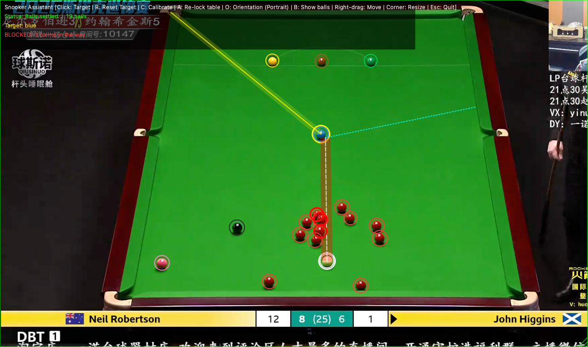

# 斯诺克画线辅助工具 (Snooker Vision Assistant)

> **推荐使用浏览器插件版**：见 [extension/README.md](extension/README.md)。插件直接读取网页视频画面，不需要截屏权限，也不用手动对齐窗口。下面是桌面悬浮窗版（Python）的说明，它也是插件识别逻辑的参考实现。

这款工具旨在通过桌面透明悬浮窗，在斯诺克直播画面上实时绘制瞄准辅助线。



## 功能特点
1.  **视角识别**：实时监控屏幕区域，自动检测是否为主转播视角（梯形桌面）。
2.  **白球追踪**：在主视角下自动定位并持续锁定母球位置。
3.  **智能画线**：
    *   点击任意目标球，自动预测进球线路。
    *   显示母球击球点。
    *   预测碰撞后母球的分离角走位（基于定杆物理规律）。
4.  **透视校准**：支持自动识别台面，也支持通过快捷键 `C` 手动点击台面四个角进行精确校准。

## 安装步骤
1.  确保您的电脑已安装 Python 3.10+。
2.  安装依赖库：
    ```bash
    pip install -r requirements.txt
    ```

## 使用说明
1.  运行程序：
    ```bash
    python main.py
    ```
2.  将弹出的透明窗口覆盖在您的直播播放器区域：**按住鼠标右键拖动**移动窗口，**拖动右下角**调整大小。移动或缩放窗口后程序会重新学习台面。
3.  **自动学习台面**：转播切到能看到整张球台的机位、并稳定约半秒后，程序会自动记住这个视角（最多记 4 个机位）。之后镜头切到球员、局部特写、回放时自动隐藏画线，切回来时立即恢复。
    *   换了一场比赛、角度变了，会自动学习新角度；也可以按 **`A`** 清空重新学习。
    *   自动识别不准时，按 **`C`** 手动依次点击球台四个角（左上、右上、右下、左下）。
4.  **开始画线**：
    *   用鼠标左键点击您想击打的 **目标球**。程序会识别每颗球的颜色（红、黄、绿、棕、蓝、粉、黑、白），并在每颗球外画对应颜色的圈（按 **`B`** 显示/隐藏）。
    *   球在滚动时不画线，所有球停稳约 0.6 秒后才计算并显示。
    *   路线按一个球的宽度画成轨迹带：只要有别的球进入这条带（球心距路线小于一个球直径），就会把这段带子标红，并把挡路的球圈出来。被球员身体暂时挡住的球仍会按最后看到的位置计入。
    *   程序在 6 个袋里优先选不被挡住、切角最小的袋口；所有袋都被挡时显示切角最小的那个并标红，切角过薄时会提示。
    *   目标球被打进或被撞走后，选中会自动取消。
5.  **重置**：按 **`R`** 键可以清除当前的目标球。
6.  **台面朝向**：默认是转播主视角（球台纵向，远端底边在上）。如果是俯视全台画面（球台横向），按 **`O`** 切换。
7.  **退出**：按 **`Esc`**。

## 测试
不需要截屏，直接用项目里的截图测试：
```bash
python test_stream.py   # 模拟直播：切镜头、遮挡、球滚动、进球；以及缩小/变暗/变亮/模糊后的识别
python test_render.py   # 生成带画线效果的测试图到 test_output/
```

## 注意事项
*   本工具基于计算机视觉识别，画面清晰度越高效果越好。
*   视角变化后（如镜头切换到球员特写），画线会自动隐藏。
*   首次运行需要在「系统设置 → 隐私与安全性 → 屏幕录制」中允许终端/Python 截屏。
*   macOS 上悬浮窗会把自己排除在截屏之外，画出的线不会干扰识别。
*   出错时，错误信息会显示在悬浮窗上，完整报错会打印在终端里。
*   走位预测目前基于“无塞定杆”物理模型，暂不支持高低杆和侧塞的模拟。

## 许可证
本项目代码以 [MIT License](LICENSE) 发布。

*   `extension/lib/opencv.js` 是 [OpenCV.js](https://opencv.org/) 的构建产物，遵循 Apache License 2.0。
*   仓库中的直播截图仅作为识别算法的测试样例，画面版权归原转播方所有。
